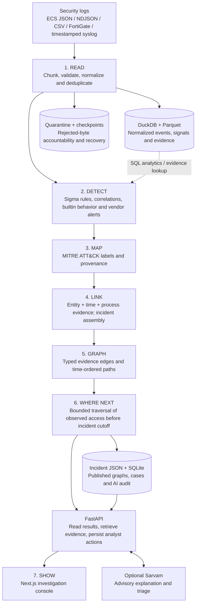

# TRACE

**Turn security logs into evidence-backed incidents, attack paths and reachable assets.**

TRACE is a local investigation tool built with Python, DuckDB, FastAPI and Next.js. It reads supported logs, detects suspicious activity, maps findings to MITRE ATT&CK, connects related evidence and shows where a compromised account or host could reach next.

The core pipeline works without an API key, Neo4j or model training. Optional Sarvam assistance adds analyst explanations and triage. A reachable asset is a hypothesis supported by observed access, not a confirmed compromise.

[Start the demo](#quick-start-for-judges) · [Architecture](#architecture) · [Your own logs](#process-your-own-logs) · [Configuration](#configuration) · [Development](docs/DEVELOPMENT.md) · [Dependencies](docs/DEPENDENCIES.md)

## Quick start for judges

The repository includes **10,000 sample EDR events** in `data/sample/edr_events.json`. No private log download or external account is needed. Clone the repository normally; the sample does not require Git LFS. Large historical benchmark files are optional.

### Option A — Docker Compose

Install [Docker Desktop](https://docs.docker.com/desktop/) with Linux containers, or Docker Engine with the Compose plugin. Start the Docker engine, then run:

```bash
git clone https://github.com/bharathgaddam1712/TRACE.git
cd TRACE
docker compose up --build
```

Open **http://localhost:3000** after the sample pipeline finishes and the web service starts. API documentation is at **http://localhost:8000/docs**.

Compose builds both applications, runs the sample pipeline, waits for successful completion, then starts the API and Next.js console. Initial image/dependency downloads require internet access; the installed core pipeline then works offline. Pipeline exit code `0` is expected: it is a one-shot job.

```bash
docker compose ps -a                 # pipeline should exit 0; api/web should be healthy
docker compose logs pipeline         # processing progress and timings
docker compose down                  # stop services; keep saved results
```

Results, analyst notes and ingestion caches persist in the `trace_results` named volume; spill uses `trace_spill`. `docker compose down --volumes` deletes those volumes: use it only when intentionally resetting the demo. Docker results are separate from a native `out/demo` run.

> Validation: the native workflow and production build are tested. Compose configuration is validated; its container smoke job is defined in [GitHub Actions](https://github.com/bharathgaddam1712/TRACE/actions). Check the run for your commit before relying on container validation.

### Option B — run locally

Prerequisites: **Python 3.11+**, **Node.js 22 LTS** and npm. Python 3.12 is the CI/container baseline. Node must meet the [Next.js requirements](https://nextjs.org/docs/app/getting-started/installation). Use an SSD and leave room for input, normalized data, caches and spill. GCC or Clang enables the optional native FortiGate lexer; it is not required for the sample.

**Windows PowerShell**, from the repository root:

```powershell
python -m venv .venv
.venv\Scripts\python.exe -m pip install -e ".[dev]"

Push-Location frontend
npm ci
npm run build
Pop-Location

.venv\Scripts\python.exe -m tracekc run --input data/sample --out out/demo
.venv\Scripts\python.exe scripts/start_web.py --out out/demo --port 3000 --api-port 8000
```

**Linux / macOS**, from the repository root:

```bash
python3 -m venv .venv
.venv/bin/python -m pip install -e '.[dev]'

(cd frontend && npm ci && npm run build)

.venv/bin/python -m tracekc run --input data/sample --out out/demo
.venv/bin/python scripts/start_web.py --out out/demo --port 3000 --api-port 8000
```

Open **http://localhost:3000**. The launcher starts both servers; it requires free ports and completed results. Server logs and process IDs are recorded under `out/demo/ui-logs/` and `out/demo/ui_processes.json`.

For an interactive development session, run the API in one terminal and the frontend in another; see [development commands](docs/DEVELOPMENT.md). Python packages are pinned in `pyproject.toml`; `npm ci` uses the committed frontend lockfile.

## What to demonstrate

1. **Overview / Data:** inspect input quality, source bytes, stage timings and run progress.
2. **Incidents:** select an incident and review its timeline, ATT&CK labels and source evidence.
3. **Attack graph:** click nodes/edges and use the path finder. **Time-ordered** requires observation times to follow a valid sequence.
4. **Where next:** inspect reachable assets and the access evidence supporting each candidate.
5. **Respond:** add analyst notes or case status; optionally request advisory Sarvam triage.

Sample example: in incident 1, open the graph and select **User: vreddy → Host: WS-HR-013** in the Time-ordered path finder. Findings depend on the input; an empty reachable list is valid when supported access is absent.

## Architecture



DuckDB handles analytical SQL locally; a separate database server is not needed. Parquet preserves the larger evidence sets, while published incident JSON serves interactive investigation. SQLite stores analyst state and AI audit/cache data. Neo4j is an optional graph mirror, not a default requirement or a guaranteed processing speedup.

### The seven stages

| Stage | What happens | Main code |
|---|---|---|
| **1. Read** | Validate supported schemas; normalize entities/timestamps; deduplicate; cache chunks and record rejected input. | `ingest.py`, `adapters.py`, `fortigate.py`, `native_reader.py`, `read_cache.py` |
| **2. Detect** | Scope compatible Sigma rules; evaluate bounded SQL batches, correlation rules, behavior baselines and vendor alerts. | `sigma.py`, `detect.py`, `rules/` |
| **3. Map** | Apply ATT&CK technique/tactic mapping, keep provenance and handle parent-technique fallback. | `label.py`, `configs/attack_mapping.yaml` |
| **4. Link** | Assemble signals using observed entities and time; score related incidents by techniques, entities and time with explanations. | `correlate.py`, `relationships.py` |
| **5. Graph** | Build evidence-backed typed edges; retrieve bounded paths, including paths constrained by observation order. | `materialize.py`, `graph_algorithms.py` |
| **6. Where next** | Traverse observed access available before the incident ended to return possible reachable assets and supporting paths. | `reach.py` |
| **7. Show** | Present incidents, graph, evidence, findings, case actions and optional AI assistance. | `api.py`, `triage.py`, `frontend/` |

Stage 6 is **next-asset reachability**. TRACE does not currently train or serve a next-technique prediction model. ATT&CK coverage is limited by supported rules and available telemetry; it is not a claim to detect every attack.

## Process your own logs

### Native run

Replace the example path with a complete local file or a directory of supported files. Keep output outside the input directory.

```powershell
.venv\Scripts\python.exe -m tracekc run --input "C:\logs\security.log" --out out/my-run
.venv\Scripts\python.exe scripts/demo_smoke.py --out out/my-run
.venv\Scripts\python.exe scripts/start_web.py --out out/my-run --port 3001 --api-port 8001
```

On Linux/macOS, replace `.venv\Scripts\python.exe` with `.venv/bin/python`. For full-file profiling, use `scripts/run_optimized_demo.py`; see [performance](docs/PERFORMANCE.md) and the [new-log checklist](docs/NEW_LOG_DEMO.md).

### Docker run

Mount a directory containing **only the files to analyze**. Stop the previous demo first; use a different Compose project name for a different dataset so its results stay separate.

```powershell
# Windows PowerShell: use an existing absolute directory with forward slashes.
$env:TRACE_INPUT_PATH = 'C:/logs/jury-input'
docker compose -p trace-jury up --build
```

```bash
# Linux/macOS
TRACE_INPUT_PATH=/absolute/path/to/jury-input docker compose -p trace-jury up --build
```

`TRACE_INPUT_PATH` replaces the sample mount. Input is read-only. Stop the old project before reusing its host ports, or set `TRACE_WEB_PORT` / `TRACE_API_PORT` to free ports. Do not run different pipelines against the same output volume concurrently.

### Supported input and quality

- ECS JSON, NDJSON/JSONL and supported gzip forms.
- CSV with the documented field aliases; native FortiGate `key=value` logs.
- Timestamped syslog with an explicit date/time and host. Arbitrary free text is not automatically converted into security events.
- Winlogbeat ECS fields feed the Active Directory rules when the required auditing data exists.

File extensions do not establish the schema. Malformed ECS JSON fails by default; FortiGate/adapter rejections have explicit diagnostics. Preserve the source and inspect quarantine/input-quality metrics. See the [data contract](docs/data_contract.md) and [reader details](docs/DUCKDB_READ.md).

## Configuration

Runtime settings live in `configs/config.yaml`. Override individual values without editing the file:

```bash
tracekc run --input data/sample --out out/tuned --set engine.threads=4 --set engine.memory_limit=1536MB
```

The default limits DuckDB buffers to 1536 MB and uses conservative concurrency. **Buffer memory is not total process RAM.** Larger thread counts or memory limits can increase paging, spill or intermediate data; measure before changing them. Large-file runtime depends on source format, valid event volume, storage and hardware. A new 30 GB run and an under-ten-minute result are not yet verified.

### Optional Sarvam assistance

The sample demo needs no `.env` file. To enable AI, copy `.env.example` to **`.env` in the repository root** and set:

```dotenv
SARVAM_API_KEY=replace_with_your_key
SARVAM_MODEL=glm5.3
```

`SARVAM_MODEL` is configurable; confirm access in your [provider model catalog](https://docs.sarvam.ai/api/token-factory/models). Request/token budgets and timeout settings are documented in `.env.example`. Restart the native servers after editing it; for Compose use `docker compose up -d --force-recreate api web` after the pipeline is complete.

Keys stay server-side. Do not add them to frontend source, `NEXT_PUBLIC_*` variables, screenshots or commits. Compose passes only the specified environment variables; it does not bake `.env` into an image. The Node proxy forwards `TRACE_API_TOKEN` to the API without exposing it to browser code.

AI output is advisory: it does not silently change detections, dismiss incidents, enable rules or contain assets. Without a key, deterministic processing and investigation still work.

## Repository layout

```text
TRACE/
├── src/tracekc/           # Python pipeline, API, reachability and triage
│   └── native/           # Optional C FortiGate tokenizer
├── frontend/             # Primary Next.js / React investigation UI
├── configs/              # Runtime, ATT&CK mapping and suppressions
├── rules/                # TRACE rules and attributed compatible SigmaHQ rules
├── data/sample/          # Small, bundled demo input
├── data/benchmarks/      # Optional historical data and measurements
├── scripts/              # Setup, demo, validation and benchmarking tools
├── tests/                # Unit, API and end-to-end regression tests
├── docs/                 # Architecture, operations, evaluation and demo guides
├── attack/               # ATT&CK bundle download/verification instructions
├── web/                  # Legacy static API view and vendored Cytoscape notice
├── Dockerfile            # Python image, including optional lexer compiler
├── frontend/Dockerfile   # Multistage Next.js production image
└── docker-compose.yml    # Sample pipeline → healthy API → web console
```

Generated results belong under ignored `out/`; local raw logs under ignored `data/raw/`. Never commit private logs, `.env`, caches or analyst databases. The Next.js console is the primary UI; `web/` remains a legacy API fallback.

## Validation and evaluation

```bash
# From an installed environment; Windows uses .venv\Scripts\python.exe.
.venv/bin/python -m pytest -q
(cd frontend && npm ci && npm run typecheck && npm run build)
.venv/bin/python scripts/demo_smoke.py --out out/demo

# Controlled sample-label evaluation; these are simulated labels.
.venv/bin/python -m tracekc eval --out out/demo --gt-from-labels data/sample/edr_events.json --save out/demo/eval.json

# Sample + planted multi-step attack loop, without AI calls.
.venv/bin/python scripts/validate_loop.py
```

For real reviewed labels, use `tracekc eval --out OUT --gt ground_truth.json --save OUT/eval.json`. The evaluator distinguishes findings retained anywhere from those promoted into incidents. Sample/planted results do not establish real-file precision or recall. [Accuracy audit](docs/ACCURACY_AUDIT.md) · [Optimization decisions](docs/OPTIMIZATION_REVIEW.md).

## Troubleshooting

| Symptom | What to check |
|---|---|
| Docker cannot connect to its daemon | Start Docker Desktop / Docker Engine and run `docker info`. |
| Console is not ready yet | Wait for sample processing and image builds; inspect `docker compose logs pipeline api web`. |
| Port already in use | Stop your earlier demo or choose unused ports. For Compose set `TRACE_WEB_PORT` and `TRACE_API_PORT`; for native use launcher flags. |
| API unreachable / HTTP 502 | Confirm the API is running and its output path matches the intended run. Native frontend defaults to `http://127.0.0.1:8000`. |
| No completed results | Run the pipeline first; inspect `progress.json` and processing logs for failures. |
| Oversized / unterminated FortiGate record | Update the reader. Closed-file quarantine can stream oversized spans without raising the parser limit; inspect rejected-byte accounting. See [reader details](docs/DUCKDB_READ.md). |
| No reachable assets | Check whether the logs contain supported account/host access evidence before the incident cutoff. Empty results can be correct. |
| Memory or disk pressure | Reduce concurrency, inspect free disk/RAM and use SSD spill. Do not assume raising DuckDB's limit improves latency. |
| Assistant unavailable | Configure a valid server-side key/model and review provider access and local usage budgets. |

## Documentation and attribution

- [Development and contribution guide](docs/DEVELOPMENT.md)
- [Packages, licenses and upstream sources](docs/DEPENDENCIES.md)
- [Jury runbook](docs/JURY_RUNBOOK.md) · [Demo guide](docs/DEMO.md)
- [Operations](docs/OPERATIONS.md) · [Performance and measurement limits](docs/PERFORMANCE.md)
- [Triage architecture](docs/TRIAGE.md) · [Incremental live-mode design — not implemented](docs/LIVE_MODE.md)

Dependencies retain their upstream licenses. SigmaHQ content carries its own [Detection Rule License](rules/community/LICENSE); vendored Cytoscape retains its [MIT notice](web/vendor/CYTOSCAPE-LICENSE.txt). No top-level license for TRACE's own code has been declared in this repository; dependency licenses do not grant rights to the whole project. See the dependency guide before redistributing third-party content.
