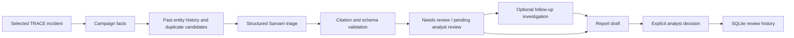

# Evidence-grounded SOC triage

Inspired by the workflow in [CERT-Shield](https://github.com/AbhivirSingh/CERT-Shield/blob/ee63df66ded9d680625ca015c2dfff544df054c7/src/agents/soc_crew.py).
TRACE implements its own DuckDB/Sarvam workflow; Elasticsearch and AWS are not required.

## What is implemented

`TriagePipeline` in `src/tracekc/triage.py` runs on demand, after the normal
pipeline produces incidents. It never runs one LLM call per raw log record.

1. **Campaign facts:** tactics, techniques, outcome counts, incident time range
   and heuristic priority, derived from all materialized timeline steps.
2. **Grounding:** parameterized DuckDB summaries for at most 12 hosts over seven
   days strictly before the incident starts; up to 20 prior shared-entity incident
   candidates within 24 hours. All query windows use incident timestamps. The
   query cannot see later replay records through `NOW()`-relative windows.
3. **Triage:** one structured Sarvam request. Up to 40 representative steps,
   selected from the start, end and highest-severity steps, with a 24 KB step
   budget, bounded event IDs and redaction. Counts and omitted-step totals remain
   visible. History query uses two threads and a 512 MB DuckDB buffer budget;
   result limits bound returned context, not necessarily the amount scanned.
4. **Validation:** Pydantic schema, enumerated assessment/priority/severity, and
   citations restricted to event IDs actually supplied. Unknown or incomplete
   evidence and provider errors preserve a reviewable case. Likely-benign output
   with omitted steps is downgraded to insufficient evidence.
5. **Optional investigation:** the existing cited investigation workflow is called
   when explicitly selected, sharing the incident and a bounded, clearly marked
   triage hypothesis. This is an additional model stage. Its existing transport
   can retry a transient provider error once. Budget reservations cover retries.
6. **Draft and review:** a Markdown draft plus explicit analyst decision
   (`escalate`, `monitor`, `likely_benign`) recorded against the exact result hash.
   No automatic alert dismissal, case closure, containment or external dispatch.

The assessment is `attack_suspected`, `likely_benign` or `insufficient_evidence`.
The workflow state is `PENDING_ANALYST_REVIEW` or `NEEDS_REVIEW`. Neither is a
ground-truth attack label. P1/P2/P3 is an advisory model recommendation, not a
calibrated probability or an automatic override of TRACE's incident score.

## Cache and audit

Results use the existing ignored `analyst.sqlite3`. Cache identity includes the
entire timeline hash, bounded context, normalized event-store signature, model,
reasoning setting, output budget, policy version and investigation choice.
Provider/validation failures are audited but not cached, permitting recovery.
Analyst reviews are append-only and must reference a result from the same incident.
Saved triage results include the grounding snapshot, elapsed time and model stages.

## Demo

In Streamlit, open **7 · Show → SOC triage workflow → Run triage agent**. The
optional investigation checkbox controls the second model stage. Download the
draft and record an analyst decision. The separate case-status form remains an
explicit action. The configured Sarvam key and local daily budgets are reused.

API endpoints:

- `GET /incidents/{id}/triage` — latest stored result and analyst review history.
- `POST /incidents/{id}/triage` with `{"investigate": false}` — run/cache triage.
- `POST /incidents/{id}/triage/review` with result `context_hash`, `decision` and
  nonempty `note` — record a human decision. API token/origin protections apply.

Old datasets without normalized `work/events.parquet` still show incidents, but
triage reports missing historical context. Run with `--keep-work` to retain it.
Caching avoids repeated LLM calls, but rechecking current evidence/history has a
cost. There is no claimed latency or accuracy gain without measuring it.

This is a fixed, bounded agent workflow, not an unrestricted planner. It does
not copy CERT-Shield's first-alert/LLM-confidence automatic dismissal gate or
interpret a draft as a legally validated compliance submission.
